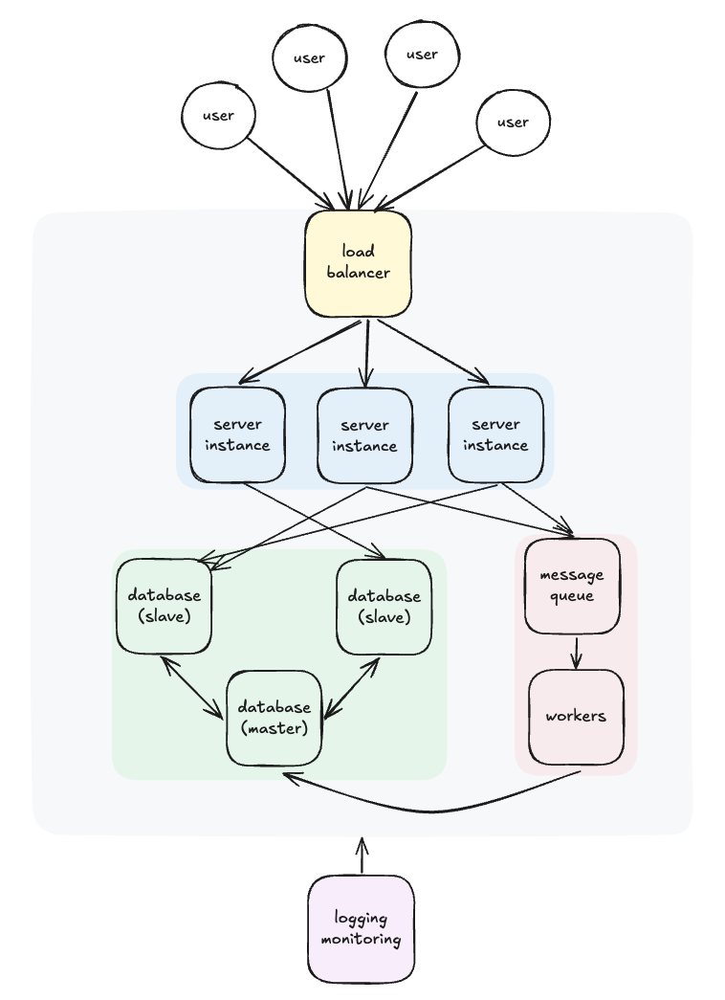

# GLUCOAST

GLUCOAST is an all-in-one dashboard to assist diabetics in managing their glucose levels throughout the day. This app helps users to track their blood sugar (glucose) levels throughout the day, by keeping a log of different variables and how they affected their blood sugar levels. 

Glucoast's goal is to help you coast throughout the day by making informed decisions on how to manage your glucose levels without unintentionally causing glucose levels to rise or crash during your day, which is a diabetic's biggest daily challenge.

## Why Did I Build This

I created Glucoast as one of my capstone projects completed during my Software Engineering bootcamp. We were required to develop a full-stack application utilizing the various technologies we learned throughout the semester. 

The front-end is built with [React](https://reactjs.org/) and is fully responsive from mobile to desktop viewports with [dynamic data visualization](https://recharts.org/en-US/). The back-end runs TypeScript and [Express](https://expressjs.com/) on top of NodeJS supporting database CRUD operations with PostgreSQL and Prisma ORM. 

## System Design Deep Dive
Similar to how Glucoast has evolved and been continuously refined since its initial creation, scaling from zero to millions of users would also require continuous refinement and endless iterations. Here, **we will explore a high level design exercise to build a robust, reliable system to handle scaling growth of our application**.  

### Humble Beginnings
Glucoast started as a local application. A frontend and backend would get served to `localhost`, with a user connecting to a single server port of each to view and use the application. While this fares well for local use, this does **not scale nor support more than one user**. 

User data was initially stored in one JSON file, but has been migrated to a Postgres database with its own defined data schema. This is a step in the right direction to support more users, but even on a single server deployment there would be numerous issues and shortcomings. Are the users located close enough to the single server to ensure low latency requests? What measures are in place to handle redundancy and fault tolerance? How do we ensure the availability of user data? By using only one server, we introduce a single point of failure for our application. **If one thing goes wrong in deployment or network environments and our application is affected, that means our application is down and our users are left with nothing**.

### Starting to scale
Scaling an application typically starts with one of two forms: **vertical scaling or horizontal scaling**. While vertical scaling would let us acquire faster and more powerful servers, there is always a hardware limit with cost and restrictions. Also, what if our all powerful server gets overloaded with user requests and response times slow to a crawl? Enter horizontal scaling.

By choosing to scale our server horizontally, we introduce a pool of servers instead of a single server to handle user requests. Naturally, this means that **our users have multiple servers to connect to when trying to reach our application**. How do we direct users to our numerous servers? In stateless HTTP applications, it shouldn't matter which server our users connect to as they should all process their requests the same. With this in mind, we can introduce a **load balancer** to our application. When requests are made, the load balancer will direct the request to one of our servers in our pool. 

### Dealing With Data
Our server has been replicated and users have additional access points to use our application. What does this mean for our database? While reads and writes could be coming from many places, they are all still being handled in one place. What happens if this database goes down or gets wiped? Safeguards are required to support the scale of users we have now acquired.

By replicating our database and establishing a master/slave relationship to handle reads and writes, we can introduce benefits to our application like:
- **better performance** since writes and reads can happen in parallel, allowing a higher query throughput
- **increase availability** of our data, still handling requests even if one instance of the database goes down
- **more reliability** due to physical distribution of data in different locations, in the event of natural disasters 

Due to restraints of the CAP theorom, we know that we must choose 2 of 3 attributes for our data being served to the client. **Partition tolerance** is a given, since in a distributed system we must expect network failures and be able to handle them gracefully. Theoretically, Glucoast would prioritize the **availability of data**, as users must be able to view medata trics at all times due to the user's need to make data informed decisions in monitoring their health. This would mean a sacrifice of **consistency**, for which measures would need to be in place to ensure **eventual consistnecy** across our other database nodes. 

#### Scaling Users Entries
Users are expected to make many entries regarding their daily health metrics. We must be able to handle the load of simultaneous users making requests, as the nature of the application is somewhat write heavy. This means **we should be able to scale our writes to the database independently**. One method to achieve this involves introducing a message queue and pub/sub architecture. 

Through queue usage, our **publishers** will create messages to be written to our database, pass them onto a queue, and messages will be picked up by **subscribers** for processing into the database. The queue usage increases the durability of message attempts being written into our system, as the publisher or the subscriber servers can still access the queue in the event of one member server being down. When the queue grows in size, workers can be scaled up to reduce the processing time of messages as well.

### Other Considerations
While our system by no means encapsulates all of the complexities of running a distributed system, there are topics which deserve mentioning for further implementation:
- **logging, metrics and automation**: we must ensure that we include robust handling to catch errors and monitor information in an accessible easy way
- further database scaling: one method which introduces further complexities is to implement **sharding across our database**; essentially, we can split the database further into shards with shard keys that requires some type of hashing function (with consistent hashing to place our writes) to ensure our data is split evenly across a set number of database servers and virtual nodes, while potentially reducing hotspots 
- **data centers**: introducing data centers can ensure that users are **geoDNS-routed** to reduce latencies, but at additional complexity costs that includes the introduction of addition toooling to handle requests geographically, and ensuring consistency of data across different regions (through additional database replication); a user should still be able to access their own data if their closest data center experiences an outage

## Author

Thanks for checking out my work! Feel free to reach out to me with any questions or to connect.

- Portfolio - [Live Site](https://nickabate.dev/)
- LinkedIn - [Nick Abate](https://www.linkedin.com/in/nick-abate/)

